<div align="center">



</div>

<div align="center">

**Next.js 15** · **React 19** · **Tailwind CSS v4** · **NestJS 11** · **Prisma** · **SQLite**


</div>

---

## What this is

A complete school ERP for **Sainik School**, covering the full lifecycle of a student —
from admission through daily operations to payroll. Not a prototype: every module listed below
is implemented, reachable through the UI, and covered by tests.

It replaces an earlier React/Vite + Hono/D1 stack and was built against a 14-module delivery plan
(`plan.txt`, extracted from the source PDF).

| Layer | Technology | Port |
|---|---|---|
| Frontend | Next.js 15 (App Router), React 19, Tailwind CSS v4 | `5173` |
| Backend | NestJS 11, Express, Swagger, 16 feature modules | `3001` |
| Database | SQLite via Prisma — 38 models, 59 indexes | `backend/prisma/dev.db` |
| Auth | JWT HS256 bearer tokens, `AuthGuard` + `RolesGuard`, branch-scoped | — |

---

## Architecture



The browser **never** talks to the backend directly — `next.config.mjs` rewrites `/api/*`
server-side, so there is no CORS preflight in the normal path and no token exposure to
client-side redirects.

---

## Modules



<details>
<summary><b>Notable implementation details</b></summary>

**Admissions** — a 9-step workflow where each step is a separate guarded endpoint, not a
free-form status field. Roll numbers follow a collision-safe `[CLASS][YEAR][SEQ]` spec
(e.g. `CLASS10A-2026-001`) computed with a max+1 loop that counts both existing students and
already-allocated admissions. Houses are allocated balanced — always the least-populated house.



**Timetable** — a constraint-satisfaction generator with backtracking that will not emit a slot
conflicting on teacher *or* room. Marking a teacher absent bulk-generates substitutions, which can
be revoked.

**Fees** — sequential document numbers (`INV-2026-0001`, `RCPT-2026-0001`) allocated with a
collision-checked loop. Payments are validated against the outstanding balance before writing.

**Payroll** — payslip generation auto-deducts unpaid-leave days from approved `Unpaid` leaves.
Verified end-to-end: 3 approved unpaid days → ₹3,000 docked from a ₹30,000 gross → ₹27,000 net.

**Discipline** — confidential notes are stored separately from the incident body and never
included in parent SMS. Every view/delete writes an audit-log entry.

**Notifications** — without `NOTIFY_WEBHOOK_URL` the service records messages with an honest
`mocked` status rather than pretending delivery succeeded. Set the env var for real dispatch.

</details>

---

## Quick start

Requires **Node v20+** (developed on v24).

```bash
# 1 ── Backend
cd backend
npm install --legacy-peer-deps
npx prisma db push     # build dev.db from schema.prisma (applies 59 indexes)
npx prisma db seed     # branch, classes, users, students, subjects, timetable
npm run start:dev      # → http://localhost:3001/api  ·  docs at /api/docs
```

```bash
# 2 ── Frontend (separate terminal)
cd frontend
npm install
npm run dev            # → http://localhost:5173
```

Swagger UI → **http://localhost:3001/api/docs**

### Environment

Copy the examples — `.env` is gitignored.

```bash
cp backend/.env.example  backend/.env
cp frontend/.env.example frontend/.env.local
```

Production boot **fails fast** if `JWT_SECRET` or `CORS_ORIGINS` is missing, rather than falling
back to a default that would let anyone with the source mint valid tokens.

---

## Demo credentials

Branch `sainik01`. Seeded classes `cls_10a`, `cls_10b`, `cls_12_sci`; students `stu_001`–`stu_004`.

| Email | Password | Role |
|---|---|---|
| `admin@sainik01.edu` | `Admin@123` | super_admin |
| `principal@sainik01.edu` | `Demo@Principal1` | branch_admin |
| `teacher@sainik01.edu` | `Demo@Teacher1` | teacher |
| `warden@sainik01.edu` | `Demo@Warden1` | warden |

The login page has one-click fills for all four.

---

## Testing

```bash
cd backend
npx jest                                  # 21 unit tests
npx jest --config test/jest-e2e.json \
         --runInBand                      # 84 e2e tests
```

**105 tests, all passing.** The e2e suite is idempotent — it cleans up every row it creates, so
consecutive runs against the same `dev.db` produce the same result.

Unit tests cover the exception filter, DTO validation rules, and JWT secret resolution.
E2E covers the full API surface, including the CSP generator, the substitution engine, the
9-step admissions flow, payroll leave-deduction, and CSV export.

> **Note:** specs that import DTOs must `import 'reflect-metadata'` — `class-validator`
> decorators need `Reflect.getMetadata`, which only exists once it's loaded.

---

## Scripts

| Command (in `backend/`) | Description |
|---|---|
| `npm run start:dev` | Watch mode on port 3001 |
| `npm run build` | Compile to `dist/` |
| `npm run start:prod` | Run compiled build |
| `npm run prisma:generate` | Regenerate Prisma Client |
| `npm run seed` | Seed demo data |
| `npm run test:e2e` | 84-test e2e suite |

| Command (in `frontend/`) | Description |
|---|---|
| `npm run dev` | Dev server on port 5173 |
| `npm run build` | Production build + typecheck |
| `npm run lint` | ESLint |

---

## Design system

The UI is built on a CSS-first Tailwind v4 design system in
`frontend/src/app/globals.css` — brand tokens live in the `@theme` block, alongside a motion
library (`fade-up`, `slide-right`, `scale-in`, `pulse-ring`, `shimmer`, `gradient-pan`).

`frontend/src/components/ui.tsx` provides the shared kit: `Reveal` (IntersectionObserver),
`AnimatedNumber` (count-up), `Tabs`, `StatCard`, `ProgressBar`, `EmptyState`, `Skeleton`,
`MailLink`/`PhoneLink`, and an `aria-live` toast host.

Accessibility is deliberate, not incidental: `prefers-reduced-motion` is honoured globally,
focus-visible rings are styled, every form control has an accessible name, and all motion
sits in the 150–300 ms range.

---

## Project layout

```
backend/
├── prisma/schema.prisma     38 models, snake_case columns via @map, 59 indexes
├── prisma/seed.ts           branch, classes, users, students, subjects, timetable
├── src/
│   ├── main.ts              bootstrap: /api prefix, helmet, CORS, Swagger, filters
│   ├── common/              AllExceptionsFilter (no internal leaks)
│   ├── auth/                guards, @Roles(), JWT secret resolution
│   └── <16 feature modules>
└── test/api.e2e-spec.ts     84 idempotent e2e tests

frontend/
├── next.config.mjs          /api/* → backend rewrite (BACKEND_URL)
└── src/
    ├── app/
    │   ├── (dashboard)/     15 protected module routes
    │   ├── admission-form/  public parent form (token-based)
    │   ├── login/  not-found.tsx  error.tsx  icon.svg
    ├── components/          DashboardShell, ui.tsx, RouteMeta, ProtectedRoute
    └── lib/api.ts           apiFetch: bearer auth + error unwrapping

assets/                      animated SVG diagrams used by this README
scripts/                     one-off codemods (idempotent) + workbook generator
```

---

## Owner

| | |
|---|---|
| **Owner** | **Jayanth** · `jayanth.m@ncetmail.com` |

---

## Known limitations

Stated plainly, because a README that oversells is worse than none:

- **Notifications are mocked** in development. Set `NOTIFY_WEBHOOK_URL` to dispatch for real.
- **SQLite** is fine for a single school but won't take concurrent writes from multiple
  instances. The Prisma schema ports to Postgres with minor changes.
- **The CBT student-facing countdown UI is not built.** The engine is complete and tested
  (server-authoritative timing, auto-grading, manual grading queue); only the timer widget is
  missing, and it was explicitly descoped.
- **No file upload for student photos.** `AdmissionDocument` exists and is tested, but there is
  no image compression pipeline because the app currently stores no raster images.
- **Rate limiting is per-instance in-memory.** Fine for a single school deployment; use Redis
  behind a load balancer if you scale out.

---

## Documentation

| Document | What it's for |
|---|---|
| [`MODULE_ASSESSMENT.md`](MODULE_ASSESSMENT.md) | Per-module honest readiness review |
| [`REQUIREMENTS_DOCUMENT.md`](REQUIREMENTS_DOCUMENT.md) | Plain-English spec, no jargon |
| [`PROJECT_MEMORY.md`](PROJECT_MEMORY.md) | Architecture, conventions, gotchas |
| `plan.txt` | Extracted delivery plan the build was measured against |
| **Swagger** | http://localhost:3001/api/docs |

---

<div align="center">


*“Every Child, Every Opportunity, Every Day.”*

</div>