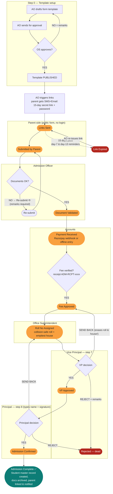

# Genesis Lumia ERP — The Simple Story of Every Login and Every Flow

> Read this top to bottom like a story. No technical words. Every diagram shows the same thing:
> **who starts it → who does what → who says YES → who says NO → where it ends.**

---

## 1. What is this system in one picture

It is the **complete office of a Sainik School**, running on a computer.
One child's life inside the school travels through it like this:

```
 A family applies        Child studies daily         Child leaves school
 ─────────────────      ─────────────────────       ──────────────────
 Admission    ──────►   Attendance  Exams  Fees  ──► TC / "Left" / Alumni
 (9 steps)              Hostel  Gate  Discipline    (exit paperwork)
                            │
                            ▼
              Adults also run their life here:
              Staff leave → Payroll, Timetable → Substitute teachers
```

Two doors to enter the system:

| Door | URL | Who uses it |
|---|---|---|
| **Staff area** | `/login` → dashboard `/` | 14 staff logins (Principal, Teacher, Accounts…) |
| **Family portal** | `/login` → `/portal` | Parent and Student only |
| **Public form** (no login!) | `/admission-form?token=...` | Parent applying for admission — link comes by SMS/Email |

---

## 2. The people (every login, its purpose, its power)

There are **16 login types**. Think of them as jobs on campus.

### 🏛️ The Bosses

| Login | Who is this, simply | Sees | Approves | Rejects |
|---|---|---|---|---|
| `super_admin` | **The owner of the software** (all schools) | Everything, in every school | Final sign of safeguarding cases | Only they can create other super admins |
| `branch_admin` / `admin` | **School office head** (full power inside ONE school) | Everything in their school | Everything | Anything |
| `principal` | **The Principal** — head of the school | Everything + secret discipline files + audit log | Final admission YES, gate pass final YES, closes discipline cases | Final admission NO |
| `vice_principal` | **The VP** — deputy principal | Almost everything (not Hostel) | Admission step 7 YES | Admission step 7 NO (sends it back) |

### 🗂️ The Office People

| Login | Who is this, simply | Sees | Approves | Rejects |
|---|---|---|---|---|
| `office_superintendent` (OS) | **The clerk-in-charge** — paperwork boss | Students, admissions, fees, reports | Admission form template, Roll number + House step | Template NO |
| `admission_officer` (AO) | **Admission desk person** | Admission pipeline, sends links | Checks documents (YES = move forward) | Bad documents → sends parent back to fix |
| `accounts` | **The fee collector** | Fees, admissions payment steps, payroll reports | Admission payment + fee approval, receipts | — (money mismatch = stop) |
| `hr` | **Staff manager** | Staff records, staff leaves, user logins | Staff leave YES, payroll run | Staff leave NO (reason required) |

### 📚 The Teachers

| Login | Who is this, simply | Sees | Approves | Rejects |
|---|---|---|---|---|
| `hod` | **Department head teacher** | Academics, timetable, reports, staff directory | Staff leave (own department), student leave, timetable changes | Same, with reason |
| `teacher` | **Class teacher** | Own classes: attendance, marks, lesson plans, CBT tests | Student leave YES/NO | Student leave NO |

### 🏠 The Hostel & Gate People

| Login | Who is this, simply | Sees | Approves | Rejects |
|---|---|---|---|---|
| `warden` | **Hostel in-charge** | Hostel rooms/beds, roll-call, gate desk, student leaves (NOT academic pages) | Gate pass stage 1, student leave | Gate pass at stage 1 |
| `security` | **Gate guard** | Gate desk + visitors + his own leave/payslip ONLY (smallest access) | Verifies OTP at gate (that's his "approval") | Wrong OTP = student does not go out |

### 🛡️ The Care Person

| Login | Who is this, simply | Sees | Approves | Rejects |
|---|---|---|---|---|
| `discipline_officer` | **Safeguarding lead** (counsellor) | Secret incident case files (only 3 logins can open these!) | Moves cases: Open → Review → Closed | Any staff member can *report* an incident |

### 👨‍👩‍👧 The Family

| Login | Who is this, simply | Sees | Can do | Cannot do |
|---|---|---|---|---|
| `parent` | **Child's parent** | ONLY their linked children | Fill admission form, pay fees, request leave & gate pass, read messages | Nothing on staff side |
| `student` | **The child** | ONLY own record | Attendance, timetable, results, write online tests | Everything else |

### Demo logins (from `backend/prisma/seed.ts` — this is the truth, some older docs are stale)

School `sainik01`:

| Email | Password | Role |
|---|---|---|
| admin@sainik01.edu | Admin@123 | super_admin |
| schooladmin@sainik01.edu | Demo@Admin1 | branch_admin |
| principal@sainik01.edu | Demo@Principal1 | principal |
| vp@sainik01.edu | Demo@Vp1 | vice_principal |
| os@sainik01.edu | Demo@Os1 | office_superintendent |
| ao@sainik01.edu | Demo@Ao1 | admission_officer |
| accounts@sainik01.edu | Demo@Accounts1 | accounts |
| hr@sainik01.edu | Demo@Hr1 | hr |
| hod@sainik01.edu | Demo@Hod1 | hod |
| teacher@sainik01.edu | Demo@Teacher1 | teacher |
| warden@sainik01.edu | Demo@Warden1 | warden |
| security@sainik01.edu | Demo@Security1 | security |
| discipline@sainik01.edu | Demo@Discipline1 | discipline_officer |
| parent@sainik01.edu | Demo@Parent1 | parent (2 children) |
| student@sainik01.edu | Demo@Student1 | student |

(A 2nd school `greenfield02` also exists with admin/teacher/parent — to prove one school can NEVER see another school's data.)

---

## 3. The moment you log in — what happens

```
        ┌────────────┐
        │  Type email │
        │  + password │
        └─────┬──────┘
              ▼
      ✔ Backend checks password
      ✔ Re-reads YOUR role from the database every single request
        (so if you are demoted/disabled mid-day, it bites instantly)
              │
              ▼
   ┌─ First-time password? ───►  FORCED page: change password.
   │                             You cannot go anywhere else until done.
   ▼
 "Are you parent / student?"
   │ yes ──►  /portal  (family view)
   │ no
   ▼
   /  (staff dashboard — different cards per job):

   Bosses        →  whole-school analytics board + approval queues
   Teacher/HOD   →  today's classes, "mark attendance", lesson plans
   Accounts/OS   →  fee collection cards
   HR            →  leave-approval pile
   Warden/Security → gate desk cards
   Safeguarding  →  confidential case card
   AO            →  admission queue
```

Every menu item is filtered by role. If you guess a forbidden URL, the screen says **Access Denied** — and even if the screen let you try, **the API blocks it anyway** (two locks on every door).

---

## 4. FLOW #1 — ADMISSION 🌟 (the big 9-step journey)

This is the star flow: a family becomes a student. **Five different approvals**, three "send-back" loops.

```
             START: AO (admission officer) sets up the form for this year
                                  │
                                  ▼
      Step 0  Template:  Draft ──► "Send for approval" ──► OS clerk APPROVES
                          │                                   │
                          │ REJECTED (by OS) ◄────────────────┘  (loop back to Draft)
                          ▼
      ═══════════ THE 9-STEP PIPELINE ═══════════

      [Links Sent] ──► AO clicks "send links"
             │  parent gets SMS+Email: a secret 15-day link + a first password
             ▼
      1. Links Sent
             ▼   parent fills form + uploads docs on public page (no login needed!)
      2. Submitted by Parent
             ▼   AO checks documents
        ├── Docs BAD ──► [Re-submit] ──► parent fixes & re-submits  ⟲ loop
        └── Docs OK ▼
      3. Document Validated
             ▼   parent pays online (Razorpay)  OR  accounts records cash
      4. Payment Received          (accounts also verifies receipt → ADM-RCPT-xxxx)
             ▼   accounts clicks "fee OK"
      5. Fee Approved
             ▼   OS clerk clicks "allocate" →  Roll No + House
      6. Roll No Assigned          (roll = CLASS10A-2026-001 style, no duplicates;
             ▼                      house = always the emptiest of Red/Blue/Green/Yellow)
      7. VP Approved               ◄── VP can SEND BACK (roll & house erased!)
             ▼                          or REJECT outright (remarks required)
      8. Admission Confirmed       ◄── Principal signs (types his name = signature)
             ▼                          or sends back one stage / rejects
      9. Admission Complete  ✅
             │
             ▼   SYSTEM does, in one transaction:
      • creates the real STUDENT record (status Active)
      • documents move into the student's file
      • parent login is linked to the child
      • parent notified.  From here the child lives in the normal school flows.
```

**Who can do what in admissions:**

| Step | Actor | Says NO → where it goes |
|---|---|---|
| Send link, check docs | Admission Officer (+admins) | Re-submit loop to parent |
| Payment, receipt, fee approve | Accounts | stops pipeline (no approval = stuck) |
| Roll + House | Office Superintendent | — |
| 7th step | **Vice Principal** | send-back erases roll & house; reject ends it |
| 8th step | **Principal** | send-back / reject |
| Anyone mid-way | VP or Principal | **Rejected** (terminal, remarks mandatory) |

Expired links: a daily 09:00 job reminds parents on day 7 and 13, then marks **Link Expired**; AO can re-issue.

### The same pipeline as a diagram (Mermaid — renders on GitHub / VS Code preview)



**Reading it:** rounded orange boxes = where the application currently sits; teal = happy end; red = dead end. Dashed arrows = automatic system events. Every "NO" either loops back (with mandatory remarks) or kills the application — nobody can silently edit a status; each arrow is one guarded endpoint and writes a step-history row.

---

## 5. FLOW #2 — A NORMAL SCHOOL MORNING (attendance)

```
 Teacher/HOD picks class ──► marks each child:  Present / Absent / Late / OD / Leave
 (Warden, Security, Parents NEVER mark class attendance)
        │
        ▼  every ABSENT child
   AUTO-SMS/Email to parents: "your child is absent"  (marked notified, no repeats)
        │
        ▼  re-marking a child present later resets it, so a new absence notifies again

 Percentage RULE (same everywhere in the system):
   % = (Present + Late + OD) ÷ (Present + Late + OD + Absent)
   Leave days & Sundays DON'T COUNT at all.        Below-75% list feeds report cards.
```

Parents/students see the calendar in the portal. Bosses/OS/HOD see registers, trends, and the "less than 75%" warning list.

---

## 6. FLOW #3 — FEES (invoice → money → receipt)

```
 Accounts builds Fee Structure per class
        │  "Generate invoices" (once per term, per ACTIVE student, no duplicates)
        ▼
   INV-<school>-2026-0001  ── status: Unpaid
        │
        ├── Parent pays ONLINE (Razorpay) from portal
        ├── Accounts records OFFLINE cash/cheque/NEFT
        ▼
   balance maths →  Partially Paid  or  Paid ✅   +  RCPT-2026-0001 receipt PDF
        │
        ▼
   Defaulters list (overdue, biggest first) → Notices/reminder messages
```

| | Who |
|---|---|
| Create invoices, collect, refund | **Accounts** (+admins) only |
| View all fees | Bosses, Accounts, OS |
| View own child's fees & pay | Parent |
| **Reject** | no "waiver" exists — amount is checked against balance; overpayment is refused (that's the "no") |

---

## 7. FLOW #4 — GATE PASS (a child leaving campus) — the strictest chain

Two human approvals **plus** a one-time password at the gate. Five actors in a row:

```
 Parent (or teacher/warden/boss) requests a pass for a child
        ▼
   [Pending]
        ▼  Warden approves                     ✗ can REJECT with reason
   [Warden Approved]
        ▼  Principal approves                  ✗ can REJECT with reason
   [Approved] ── system creates: 6-digit OTP (only its hash is stored)
        │                        + a printable pass code + QR PDF
        │                        + parent is notified of the OTP
        ▼  gate desk (Security / Warden / boss) verifies OTP
   [Checked Out]     wrong OTP ×5 = locked out  ✗ no OTP = child stays in
        ▼
   [Returned] ✚ if later than promised time, flagged LATE + parents notified
```

Hostel night roll-call has its own mini-flow: **Absent at night session → 1 SMS to parent, automatically.**

---

## 8. FLOW #5 — LEAVES (two separate queues)

### Staff member's own leave

```
 Staff applies (self; HR/admins can apply on behalf)
        ▼
   [Pending] ──► approver:  HOD (own dept only) / HR / Bosses
        │            ✗ RULE: nobody approves their OWN leave
        │            ✗ REJECT must carry a reason
        ▼
   [Approved] or [Rejected] or staff [Withdrawn] before decision
        │
        ▼  invisible consequence:
   Approved UNPAID days (or days beyond quota: Casual 12 / Sick 8 / Earned 15 / Duty 10)
   are AUTOMATICALLY DOCKED from that month's salary.
```

### Student's leave

```
 Parent requests (portal)  OR  OS/warden/teacher/boss files it
        ▼
   [Pending] ──► Warden / Teacher / HOD / Boss decides ──► Approved/Rejected
        │                                                  (parent notified)
        ▼
   Approved leaves AUTO-FILL the attendance sheet ("this child is on approved leave")
   and pre-fill hostel roll-call as "On Leave".  A filer can Cancel before decision.
```

---

## 9. FLOW #6 — EXAMS → REPORT CARD (the publish gate)

```
 HOD/Bosses: define exam + grade bands (bands must cover 0–100, no gaps)
        ▼
 Teacher: enters marks (0..max, all-or-nothing save)  ──► card shows "Provisional"
        ▼
 computed: subject % (weighted) → overall % → grade → rank (1,2,2,4 style)
        ▼
 HOD/Bosses click PUBLISH  ──► frozen snapshot per child/term
        │                      (re-publishing needs confirm:true)
        ▼
 ONLY published cards reach parent/student portal. Unpublished = invisible to family.
```

**CBT (online tests)** work the same way: teacher authors Draft → **Published** → student attempts with a **server-side timer** (auto-submits if time runs out) → MCQs auto-graded, essays sit in the teacher's grading queue.

---

## 10. FLOW #7 — SALARY (payroll)

```
 HR/Accounts set Salary Structure (basic + HRA + DA, TDS, EPF, PT)
        ▼
 monthly run: payslips [Draft] ──► finalize whole month ──► [Generated] ──► paid ──► [Paid]
        │           (recalculation allowed only while Draft)      ✗ can't mark Paid from Draft
        ▼
 auto-deduction: unpaid leave days from Flow #5 docked = basic/30 per day (capped at basic)
        ▼
 Staff sees ONLY their own released slip (Generated/Paid), can download PDF.
 Salary numbers NEVER appear in the staff directory. Only Admins/HR/Accounts run payroll.
```

---

## 11. FLOW #8 — TIMETABLE & the "teacher is sick" chain

```
 HOD/Bosses click GENERATE → solver fills every slot with backtracking:
    no teacher double-booked, no room clash, ≤6 periods/day, no same subject twice in a row.
        │
        ▼  teacher marks ABSENT for the day
    SYSTEM auto-creates a SUBSTITUTE for every now-uncovered period:
    picks the least-loaded free teacher (checks their leave, exams, other covers)
        │            ✗ admin can Cancel (substitute emailed)
        ▼
    substitute gets an email; the class gets a board notice;
    the "assigned cover" temporarily gives that teacher rights to mark THAT class's attendance
```

---

## 12. FLOW #9 — DISCIPLINE / SAFEGUARDING (the secret one)

```
 ANY staff member reports an incident  (severity Low/Medium/High/Critical)
        ▼
   [Open] ──► High/Critical: AUTO-escalates + emails all principals
   [Under Review] ──► case team only
   [Closed]        ──► re-OPENING needs the PRINCIPAL + a reason
        ✗ Reject/delete = super_admin or principal only (soft delete, never erased)

 WHO CAN OPEN THE FILES: only super_admin, principal, discipline_officer.
 → deliberately even branch_admin (IT admins) CANNOT read safeguarding files.
 → the reporter sees only their own report, without confidential notes.
 → EVERY view/list/delete is written to an audit log. Confidential notes never go in parent SMS.
```

---

## 13. FLOW #10 — MESSAGES (everything talks to parents)

```
 Anything happens (absence, gate pass, receipt, admission step, report card…)
        ▼
 notify() picks a driver: Email(SMTP) / SMS(MSG91|Twilio) / WhatsApp
        ▼
   sent ✓  |  failed ✗ → retries at 1m, 5m, 30m, 2h (max 5)  |  mocked (no config, honest log)
        ▼
 every message lands in the Outbound Log — visible to Bosses/OS/AO.
 OTPs/passwords in a message body are MASKED and never retried.
 Noticeboard: bosses/OS/AO can publish school-wide; teachers only to their own classes.
```

---

## 14. The full life of one student, start to finish

```
 ADMISSION (Flow 1) ─► ACTIVE student ─► daily life:
 │        Attendance (2) · Fees (3) · Timetable (8) · Exams & report cards (9)
 │        Hostel beds & roll-call · Gate passes (4) · Leaves (5) · Discipline (10) · Messages (11)
 │
 └─► THE EXIT (there is no "passout button" — it's a status change):
        OS/Boss/Principal sets status →  Left / Transferred / Alumni  (reason audited)
        + Transfer Certificate PDF (TC-<code>-<admissionNo>) — only once NOT Active
        + hard DELETE is refused if history exists — the system prefers status over deletion
```

---

## 15. Cheat sheet — who APPROVES what (one glance)

| Thing | Start → … → Final YES | Who can say NO, and what NO does |
|---|---|---|
| Admission form template | AO drafts → **OS** publishes | OS rejects → back to Draft |
| Admission application | AO → Accounts → OS → **VP** → **Principal** | VP: erases roll no. & sends back; VP/Principal: Rejected = dead |
| Documents | Parent uploads → **AO** validates | AO: Re-submit = parent fixes |
| Fee invoice payment | Parent/Accounts → **Accounts** verifies receipt | wrong amount = refused |
| Staff leave | Staff → **HOD (own dept) / HR / Boss** | reject+reason; never self-approval |
| Student leave | Parent/staff → **Warden / Teacher / HOD / Boss** | reject; parent notified either way |
| Gate pass | Request → **Warden** → **Principal** → **Gate OTP** | reject at both stages; wrong OTP = no exit |
| Report card | Teacher marks → **HOD/Boss publishes** | unpublished = family can't see |
| CBT test | Teacher drafts → **publishes** | can't delete once attempted |
| Class timetable / covers | Teacher requests → **HOD/Boss assigns/cancels** | conflict = refused with reasons |
| Payroll | HR/Accounts generate → **finalize** → **mark paid** | Draft can't be marked paid |
| Discipline case | Any staff reports → **case team reviews** → **Principal closes/reopens** | delete = super_admin/Principal only |
| User account | Admin/HR creates | only super_admin can make a super_admin; HR can't touch admins; you can't disable yourself |

## 16. Safety rules that never change

- **Two locks on every door** — menus hide pages per role, and the API re-checks on every call (role is re-read from the database each request).
- **School walls** — every query is filtered by branch; school B can never read school A, and probing a foreign ID returns 404 (so IDs can't be guessed).
- **Everything is logged** — who created, viewed, approved, rejected, exported, escalated — in an audit log (Principal/Admins read it; discipline history is read only by the case team).
- **Secrets stay secret** — gate OTPs stored as hash only, admission links expiring in 15 days, passwords masked in message logs, file downloads via short-lived signed URLs.

---

### Where this in the code (for the curious)

| Concept | File |
|---|---|
| The role list & permission groups | `backend/src/auth/roles.ts` (mirrored in `frontend/src/lib/auth.tsx`) |
| Which pages each role sees | `frontend/src/lib/nav.ts` (`canAccess`) |
| Admission state machine (the 9 steps) | `backend/src/admissions/workflow.ts` |
| Gate pass chain | `backend/src/leaves/gate-pass.controller.ts` |
| Demo users | `backend/prisma/seed.ts` (`DEMO_LOGINS`) |
| Every endpoint's allowed roles | each `*.controller.ts` — the `@Roles(...)` decorator |

> Note: older root docs (DEMO_GUIDE.md, MODULES_DOCS.md, features_documentation.md) describe the previous stack and are partly stale. `PROJECT_MEMORY.md` and the code are the truth. This guide was written from the code.
