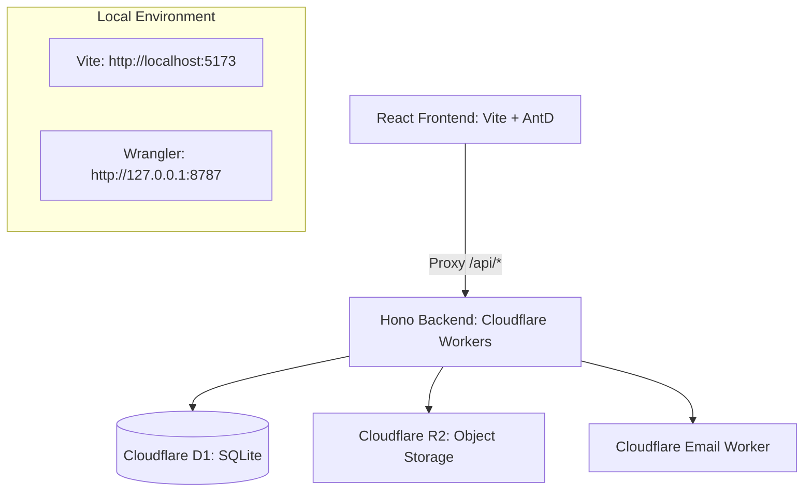

# Genesis ERP — Module & Feature Documentation

This document provides a comprehensive technical breakdown of all **13 modules** implemented in the **Genesis ERP** platform. It describes the functional purpose, database schemas, backend routes, frontend components, and overall workflows for each module.

---

## 🛠️ Tech Stack & Architecture Overview

Genesis ERP is designed using a modern, serverless, edge-first architecture:
*   **Frontend**: React 19, Vite 8, and Ant Design Pro (`@ant-design/pro-components`) for a premium enterprise SaaS design.
*   **Backend**: Hono 4 running on Cloudflare Workers (Fast, global, low latency).
*   **Database**: Cloudflare D1 (Serverless SQLite database).
*   **Storage**: Cloudflare R2 Bucket (`genesiserp-documents`) for student documents and parent uploads.
*   **Email**: Cloudflare Email Workers for broadcasts and OTP verification.

---

## 📦 Module Breakdown & Feature List

### 1. Admissions (Module 1)
*   **Purpose**: Manages a structured **9-step onboarding workflow** for new student applications.
*   **Workflow Steps**:
    1.  **AO Setup**: Admission Officer (AO) builds dynamic mandatory fields.
    2.  **OS Approval**: Office Superintendent (OS) reviews and approves the mandatory fields.
    3.  **Trigger Links**: AO triggers login IDs and password links to parent emails/SMS.
    4.  **Form Submission**: Parents log in, fill in dynamic forms, upload documents to Cloudflare R2.
    5.  **Doc Validation**: AO reviews documents and triggers a fee payment link.
    6.  **Fee Payment**: Parent simulates an offline/online payment.
    7.  **Accounts Verification**: Accounts department approves the payment receipt.
    8.  **Roll No & House Allocation**: OS automatically assigns a sequential Roll No (`6-2026-SEQ`) and random House (Red/Blue/Green/Yellow).
    9.  **VP & Principal Digital Sign-off**: Vice Principal (VP) and Principal sign off on the admission, migrating the record to the Student Master table.
*   **Database Tables**: `admissions`, `admission_fields`
*   **Source Code**:
    *   Backend Routes: [admissions.ts](file:///d:/genesiserp/backend/src/routes/admissions.ts)
    *   Frontend Component: [AdmissionsForm.tsx](file:///d:/genesiserp/frontend/src/features/admissions/AdmissionsForm.tsx)

---

### 2. Student Information System (SIS) (Module 2)
*   **Purpose**: Acts as a 360-degree master record for enrolled students.
*   **Features**:
    *   Detailed personal records, parent details, contact info.
    *   Physical metrics tracking (height, weight, blood group, vision).
    *   Secure Document Vault for uploading government IDs (Aadhar) and medical logs to Cloudflare R2.
*   **Database Tables**: `students`
*   **Source Code**:
    *   Backend Routes: [index.ts](file:///d:/genesiserp/backend/src/index.ts)
    *   Frontend Component: [StudentProfile.tsx](file:///d:/genesiserp/frontend/src/features/sis/StudentProfile.tsx)

---

### 3. Academics (Module 3)
*   **Purpose**: Manages syllabi, class lesson plans, and assignments.
*   **Features**:
    *   Syllabus breakdown by class level and subject.
    *   Creation and tracking of teacher lesson plans.
    *   Teacher assignment manager with title, descriptions, and due dates.
*   **Database Tables**: `syllabus`, `lesson_plans`, `assignments`
*   **Source Code**:
    *   Backend Routes: [academics.ts](file:///d:/genesiserp/backend/src/routes/academics.ts)

---

### 4. Attendance (Module 4)
*   **Purpose**: Logs daily attendance with hardware integration and manual overrides.
*   **Features**:
    *   **CAMS Biometric Webhook**: Receives real-time biometric JSON punch logs directly from legacy hardware.
    *   **Manual Tracker**: Allows teachers to manually review, mark, and correct student attendance.
    *   **Absence Notification**: Auto-sends emails notifying parents of absent students.
*   **Database Tables**: `attendance`
*   **Source Code**:
    *   Backend Routes: [attendance.ts](file:///d:/genesiserp/backend/src/routes/attendance.ts)
    *   Frontend Component: [AttendanceTracker.tsx](file:///d:/genesiserp/frontend/src/features/attendance/AttendanceTracker.tsx)

---

### 5. Hostel Management (Module 5)
*   **Purpose**: Administers housing, rooms, and student bed allocations.
*   **Features**:
    *   Hostel house listing, warden assignments, and housing capacities.
    *   Room-level student allocation tracker.
*   **Database Tables**: `hostels`, `rooms`, `hostel_allocations`
*   **Source Code**:
    *   Backend Routes: [hostel.ts](file:///d:/genesiserp/backend/src/routes/hostel.ts)

---

### 6. Timetable & Substitution (Module 6)
*   **Purpose**: Controls class schedules and handles automated teacher substitution.
*   **Features**:
    *   **Master Schedule**: Class schedules mapping subjects and teachers for each day of the week.
    *   **Live Substitution Overlay**: Overlay on the active schedule if a teacher is absent.
    *   **Automatic Substitution Solver**: Suggests alternative teachers for an absent slot based on scheduling constraints (free periods, active status, max daily limits).
*   **Database Tables**: `timetable`, `substitutions`, `teachers`
*   **Source Code**:
    *   Backend Core & CSP Algorithm: [timetable.ts](file:///d:/genesiserp/backend/src/timetable.ts)
    *   Frontend Component: [SubstitutionGrid.tsx](file:///d:/genesiserp/frontend/src/features/timetable/SubstitutionGrid.tsx)

---

### 7. Leave / Gate Pass (Module 7)
*   **Purpose**: Manages student leave approvals and gate security.
*   **Features**:
    *   **Parent OTP Verification**: Generates a 6-digit OTP emailed to parents for digital consent before leave requests are submitted.
    *   **Tiered Approvals**: 
        *   *Regular Leaves*: Approved by the Hostel Warden.
        *   *Emergency Leaves*: Egress requests require multi-factor approvals (Hostel Warden -> Principal).
*   **Database Tables**: `gate_passes`
*   **Source Code**:
    *   Backend Routes: [hostel.ts](file:///d:/genesiserp/backend/src/routes/hostel.ts)

---

### 8. Fees & Payments (Module 8)
*   **Purpose**: Handles school invoices and cash collections.
*   **Features**:
    *   Generates fee structures and student invoices.
    *   **Offline Collections**: Records payments made via Cash, Cheque, NEFT/RTGS, and DD.
    *   Auto-updates invoice status to `Paid` or `Partial` depending on the cumulative amount collected.
*   **Database Tables**: `fee_structures`, `fee_invoices`, `offline_payments`
*   **Source Code**:
    *   Backend Routes: [finance.ts](file:///d:/genesiserp/backend/src/routes/finance.ts)
    *   Frontend Component: [FeeLedger.tsx](file:///d:/genesiserp/frontend/src/features/finance/FeeLedger.tsx)

---

### 9. Parent Communication (Module 9)
*   **Purpose**: School-wide notifications and parent alerts.
*   **Features**:
    *   **Email Broadcasts**: Admin/Principal dashboard to broadcast announcements to specific classes or the entire branch.
    *   Integrates natively with Cloudflare Email Workers.
*   **Source Code**:
    *   Backend Routes: [communication.ts](file:///d:/genesiserp/backend/src/routes/communication.ts)

---

### 10. Payroll (Module 10)
*   **Purpose**: Calculates staff salaries and handles tax/pension compliance.
*   **Features**:
    *   Calculates Gross Salary dynamically (Basic + HRA + DA).
    *   **Dynamic Overrides**: Allows administrators to override default TDS (tax) and EPF (pension) rates based on regional regulations.
    *   Generates comprehensive monthly staff payslips.
*   **Database Tables**: `salary_structures`, `payslips`
*   **Source Code**:
    *   Backend Routes: [finance.ts](file:///d:/genesiserp/backend/src/routes/finance.ts)

---

### 11. Discipline & Safeguarding (Module 11)
*   **Purpose**: Documents student incidents and compliance logs.
*   **Features**:
    *   Logs behavioral incidents, demerits, actions taken, and the reporting warden/teacher.
    *   Maintains a secure, timestamped audit log.
*   **Database Tables**: `incidents`
*   **Source Code**:
    *   Frontend Component: [IncidentLog.tsx](file:///d:/genesiserp/frontend/src/features/discipline/IncidentLog.tsx)

---

### 12. Staff Management (Module 12)
*   **Purpose**: Manages employee profiles and leave requests.
*   **Features**:
    *   Staff directory tracking roles (Super Admin, Admin, Warden, Teacher).
    *   **Staff Leave Approval Flow**: Allows staff to request casual, sick, and earned leaves, which are queued for HOD/Admin approval.
*   **Database Tables**: `staff`, `staff_leaves`
*   **Source Code**:
    *   Backend Routes: [staff.ts](file:///d:/genesiserp/backend/src/routes/staff.ts)

---

### 13. Reports & Dashboards (Module 13)
*   **Purpose**: Consolidates live metrics and administrative updates for school leaders.
*   **Features**:
    *   Real-time counters for daily attendance rate, collections, active gate passes, and pending approvals.
    *   Direct interactive links to pending actions requiring Principal sign-off.
*   **Source Code**:
    *   Frontend Component: [AdminDashboard.tsx](file:///d:/genesiserp/frontend/src/features/reports/AdminDashboard.tsx)
