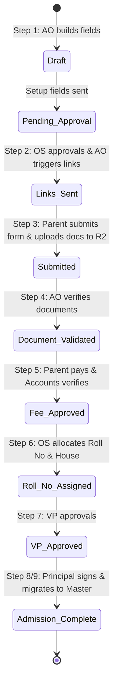

# Admissions & SIS (Modules 1 & 2)

This document provides a detailed functional and technical breakdown of **Module 1 (Admissions)** and **Module 2 (Student Information System)** in the Genesis ERP system.

---

## 📦 Admissions Onboarding (Module 1)

The Admissions module implements a structured **9-step onboarding workflow** that coordinates actions between the Admission Officer (AO), Office Superintendent (OS), Accounts department, Vice Principal (VP), Principal, and the Applicant's Parent.

### 1. The 9-Stage Workflow Details

1.  **Draft / Setup Fields**: The Admission Officer (AO) builds dynamic mandatory fields using a drag-and-drop builder interface in the admin panel.
2.  **OS Setup Field Approval**: The OS reviews the fields. Once approved, the fields are published, and the application portal opens.
3.  **Trigger Links**: The AO inputs parent contact details. The system generates secure Parent Login IDs and passwords, auto-dispatching login credentials to parent emails.
4.  **Parent Submission**: Parents log in, fill in the dynamically rendered form fields, and upload required documents (Aadhar card, birth certificate, medical reports).
    *   *R2 Storage*: Files are uploaded directly to the Cloudflare R2 bucket (`genesiserp-documents`) under the folder `admissions/br_sainik_01/{application_id}/`.
5.  **AO Document Validation**: The AO reviews parent uploads. If correct, the AO approves the docs, which automatically triggers a fee payment link. If invalid, it reverts to parent revision with custom remarks.
6.  **Fee Payment & Verification**: Parents log in and click "Simulate Payment". The Accounts department reviews the transaction and marks the payment receipt as "Verified" (Fee Approved).
7.  **Roll No & House Allocation**: The OS reviews the application, allocating a sequential Roll Number (`6-2026-SEQ`) and randomly assigning a School House (`Red`, `Blue`, `Green`, `Yellow`).
8.  **VP Approval**: The Vice Principal signs off on the assigned House and Roll Number.
9.  **Principal Approval & Migration**: The Principal executes the digital sign-off. This triggers a backend transaction that:
    *   Updates the admission status to `Admission Complete`.
    *   Extracts student data from `admissions.dynamic_data` (JSON).
    *   Inserts the new record into the master `students` table.
    *   Mocks an email confirmation sent to the parent.

### 📂 Key Source Code Reference
*   Backend Controller: [admissions.ts (Backend)](file:///d:/genesiserp/backend/src/routes/admissions.ts)
*   Frontend Component: [AdmissionsForm.tsx (Frontend)](file:///d:/genesiserp/frontend/src/features/admissions/AdmissionsForm.tsx)

---

## 🎒 Student Information System (SIS) (Module 2)

The SIS module maintains the unified **360-Degree Profile** for all enrolled students. It replaces paper record registers with digital records.

### 1. Features
*   **Comprehensive Student Profile**: Displays personal records, parent/guardian contact details, and current enrollment status.
*   **Physical & Medical Metrics Tracking**: Keeps records of vital student data including **blood group**, **height (cm)**, **weight (kg)**, and **vision index** (e.g. `6/6`, `6/9`).
*   **Secure Document Vault**: An upload and retrieval portal for important student documents (Aadhar card, military/medical certificates, entrance logs) stored securely in Cloudflare R2.

### 📂 Key Source Code Reference
*   Backend Controller: Query routes inside [index.ts (Backend)](file:///d:/genesiserp/backend/src/index.ts#L112-L147)
*   Frontend Component: [StudentProfile.tsx (Frontend)](file:///d:/genesiserp/frontend/src/features/sis/StudentProfile.tsx)
