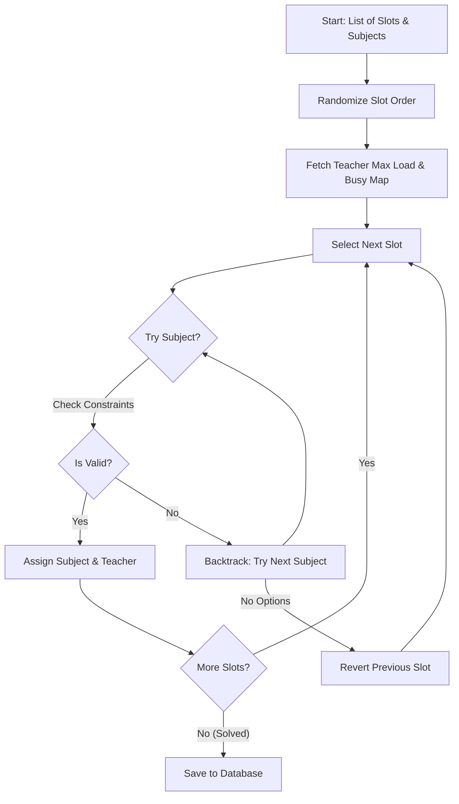

# Timetable & Substitution (Module 6)

This document provides a detailed technical guide to **Module 6 (Timetable & Substitution)**, covering database queries, frontend views, and the auto-scheduling algorithm.

---

## ⚡ Auto-Timetable Generation (CSP Solver)

The timetable generator implements a **Constraint Satisfaction Problem (CSP) solver** written in TypeScript to automate weekly scheduling.

*   **Endpoint**: `POST /api/timetable/generate`
*   **Input**: Class ID, periods per day, selected days, and a list of subjects with assigned teachers and their required periods per week.
*   **Validation**: The total periods required must match the total slots available (Days × Periods/Day).
*   **Algorithm**: Greedy backtracking with a fail-first heuristic. It randomizes cells to avoid patterns, then attempts to assign subjects with the highest remaining quota first.

### Constraints Enforced by `backtrack()`
Inside [timetable.ts](file:///d:/genesiserp/backend/src/timetable.ts#L438-L491):
1.  **No Double-Booking**: A teacher cannot be scheduled to teach another class in the same day and period.
2.  **No Consecutive Periods**: The same subject cannot be scheduled back-to-back in a class on the same day (prevents student fatigue).
3.  **Teacher Workload Limit**: The teacher's daily period count cannot exceed their `max_periods_per_day` limit (default 6) in the `staff` table.

---

## 🔄 Teacher Absence & Bulk Auto-Substitution

When a teacher is absent, the coordinator marks them absent for the day. The system automatically covers all their scheduled periods:

1.  **Absent Query**: The system queries the `timetable` table for all classes and periods scheduled for the absent teacher on that day of the week.
2.  **Constraint Solver (`assignSubstitute`)**: For each affected period, the system searches the `staff` table for a substitute:
    *   The substitute must be a `Teacher`.
    *   The substitute must be active (`is_active = 1`).
    *   The substitute must not be teaching another class during that period (primary or sub).
    *   The substitute must not exceed their `max_periods_per_day` workload.
3.  **Substitution Overlay**: The substitute is saved in the `substitutions` table. The master timetable remains unchanged, keeping the audit log intact.
4.  **Live View Grid**: When fetching today's timetable, the API merges master slots with the `substitutions` table, displaying the substitute teacher with a swap indicator.

---

## 📂 Codebase Reference Mappings

*   **Backend Routing & Algorithm**: [timetable.ts (Backend)](file:///d:/genesiserp/backend/src/timetable.ts)
    *   `backtrack()`: The CSP backtracking function.
    *   `assignSubstitute()`: Finds and inserts substitute teachers.
    *   `/generate` / `/substitute` / `/teachers/:id/absent` / `/school-view` endpoints.
*   **Frontend UI Component**: [SubstitutionGrid.tsx (Frontend)](file:///d:/genesiserp/frontend/src/features/timetable/SubstitutionGrid.tsx)
    *   `LiveView`: Displays class cards and substitution actions.
    *   `MasterGrid`: Renders a class's weekly schedule.
    *   `GenerateWizard`: Configures class schedules.
    *   `TeachersPanel`: Staff directory and active limits toggles.
*   **Custom Styling Sheet**: [Timetable.css (Frontend CSS)](file:///d:/genesiserp/frontend/src/features/timetable/Timetable.css)
